# Odoo Custom Addons

[](https://github.com/Paulius11/odoo-custom-addons/actions/workflows/test.yml?query=branch%3A17.0)
[](https://apps.odoo.com/apps/modules/browse?author=Paulius%20Gaizauskas)
[](https://www.gnu.org/licenses/lgpl-3.0)

Free, open-source Odoo modules for admins and everyday users. Each Odoo series has its own
branch (`17.0`, `18.0`, `19.0`, `20.0`); this is the **17.0** branch. All modules are
also on the [Odoo Apps Store](https://apps.odoo.com/apps/modules/browse?author=Paulius%20Gaizauskas).

## Modules

<!-- modules:start -->
| | Module | What it does | 17.0 | 18.0 | 19.0 | 20.0 |
|---|---|---|---|---|---|---|
|  | [Advance Payments](simple_payment_advance/) | Customer deposits and vendor prepayments, applied to invoices later | [✓](https://github.com/Paulius11/odoo-custom-addons/tree/17.0/simple_payment_advance) | [✓](https://github.com/Paulius11/odoo-custom-addons/tree/18.0/simple_payment_advance) | [✓](https://github.com/Paulius11/odoo-custom-addons/tree/19.0/simple_payment_advance) |  |
|  | [Debug Field Copy](debug_field_copy/) | Copy field names from debug tooltip | [✓](https://github.com/Paulius11/odoo-custom-addons/tree/17.0/debug_field_copy) | [✓](https://github.com/Paulius11/odoo-custom-addons/tree/18.0/debug_field_copy) | [✓](https://github.com/Paulius11/odoo-custom-addons/tree/19.0/debug_field_copy) | [✓](https://github.com/Paulius11/odoo-custom-addons/tree/20.0/debug_field_copy) |
|  | [Debug Logger](debug_logger/) | Log create, write, delete and search calls for debugging | [✓](https://github.com/Paulius11/odoo-custom-addons/tree/17.0/debug_logger) |  |  |  |
|  | [Easy Translation Override](custom_translate/) | Click any Odoo text and change its translation: draft, apply, revert | [✓](https://github.com/Paulius11/odoo-custom-addons/tree/17.0/custom_translate) |  |  |  |
|  | [List Arrow Keys](web_list_arrow_keys/) | Arrow keys move between cells of an editable list, like a spreadsheet | [✓](https://github.com/Paulius11/odoo-custom-addons/tree/17.0/web_list_arrow_keys) |  |  |  |
|  | [List View Column Presets](web_listview_column_presets/) | Save the columns of a list view as presets, switch back in one click | [✓](https://github.com/Paulius11/odoo-custom-addons/tree/17.0/web_listview_column_presets) |  |  |  |
|  | Log Real IP | Show real client IP in werkzeug logs when behind a reverse proxy |  | [✓](https://github.com/Paulius11/odoo-custom-addons/tree/18.0/log_real_ip) | [✓](https://github.com/Paulius11/odoo-custom-addons/tree/19.0/log_real_ip) | [✓](https://github.com/Paulius11/odoo-custom-addons/tree/20.0/log_real_ip) |
|  | [Lost Emails](mail_lost/) | Keep incoming emails that Odoo cannot route, and route them by hand | [✓](https://github.com/Paulius11/odoo-custom-addons/tree/17.0/mail_lost) | [✓](https://github.com/Paulius11/odoo-custom-addons/tree/18.0/mail_lost) | [✓](https://github.com/Paulius11/odoo-custom-addons/tree/19.0/mail_lost) | [✓](https://github.com/Paulius11/odoo-custom-addons/tree/20.0/mail_lost) |
|  | [Module Version](module_version/) | Display module version, track lifecycle history, and check for App Store updates | [✓](https://github.com/Paulius11/odoo-custom-addons/tree/17.0/module_version) | [✓](https://github.com/Paulius11/odoo-custom-addons/tree/18.0/module_version) | [✓](https://github.com/Paulius11/odoo-custom-addons/tree/19.0/module_version) | [✓](https://github.com/Paulius11/odoo-custom-addons/tree/20.0/module_version) |
|  | POS Network Printer | Receipts and kitchen tickets on ESC/POS network printers, no IoT box |  |  | [✓](https://github.com/Paulius11/odoo-custom-addons/tree/19.0/pos_escpos_printer) |  |
|  | [Quick Language Switcher](language_change/) | Fast language switching from the Odoo interface | [✓](https://github.com/Paulius11/odoo-custom-addons/tree/17.0/language_change) | [✓](https://github.com/Paulius11/odoo-custom-addons/tree/18.0/language_change) | [✓](https://github.com/Paulius11/odoo-custom-addons/tree/19.0/language_change) | [✓](https://github.com/Paulius11/odoo-custom-addons/tree/20.0/language_change) |
|  | [Simple Online Users](simple_online_users/) | Display online users count in systray | [✓](https://github.com/Paulius11/odoo-custom-addons/tree/17.0/simple_online_users) | [✓](https://github.com/Paulius11/odoo-custom-addons/tree/18.0/simple_online_users) | [✓](https://github.com/Paulius11/odoo-custom-addons/tree/19.0/simple_online_users) | [✓](https://github.com/Paulius11/odoo-custom-addons/tree/20.0/simple_online_users) |
|  | [Simple Scheduled Reports](simple_scheduled_reports/) | Email any filtered list as a table and Excel file on a schedule | [✓](https://github.com/Paulius11/odoo-custom-addons/tree/17.0/simple_scheduled_reports) |  |  |  |
|  | [Simple User Menu Sort](simple_user_menu_sort/) | Each user sorts the main app menu in their own order | [✓](https://github.com/Paulius11/odoo-custom-addons/tree/17.0/simple_user_menu_sort) |  |  |  |
|  | [User Activity Monitor](user_session_monitor/) | Track user login sessions and detect unusual activity patterns | [✓](https://github.com/Paulius11/odoo-custom-addons/tree/17.0/user_session_monitor) |  |  |  |
|  | [User Permission Copy](user_permission_copy/) | Copy user permissions from one user to another | [✓](https://github.com/Paulius11/odoo-custom-addons/tree/17.0/user_permission_copy) | [✓](https://github.com/Paulius11/odoo-custom-addons/tree/18.0/user_permission_copy) | [✓](https://github.com/Paulius11/odoo-custom-addons/tree/19.0/user_permission_copy) | [✓](https://github.com/Paulius11/odoo-custom-addons/tree/20.0/user_permission_copy) |

## Screenshots

### Advance Payments

Customer deposits and vendor prepayments, applied to invoices later

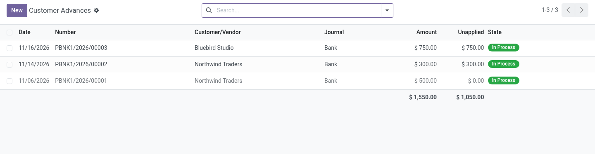

### Debug Field Copy

Copy field names from debug tooltip

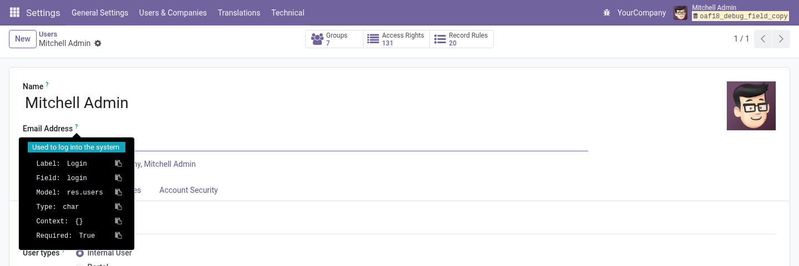

### Debug Logger

Log create, write, delete and search calls for debugging

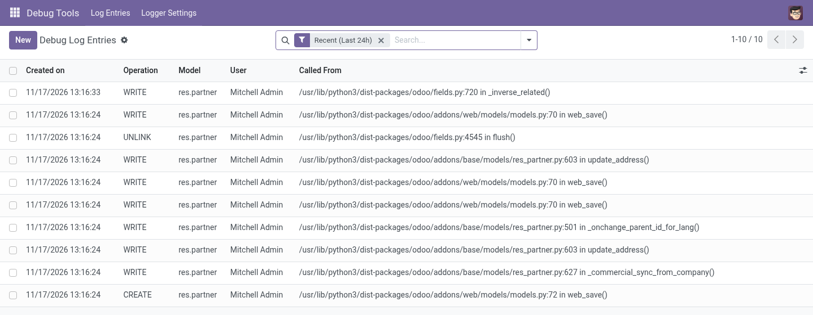

### Easy Translation Override

Click any Odoo text and change its translation: draft, apply, revert

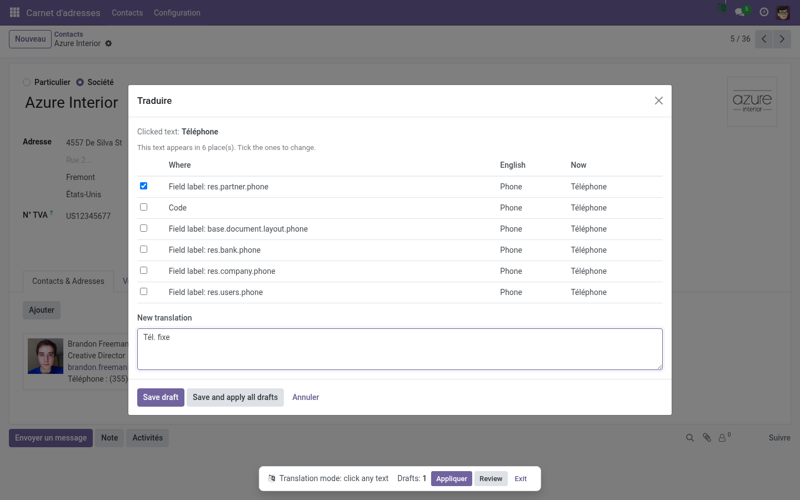

### List Arrow Keys

Arrow keys move between cells of an editable list, like a spreadsheet

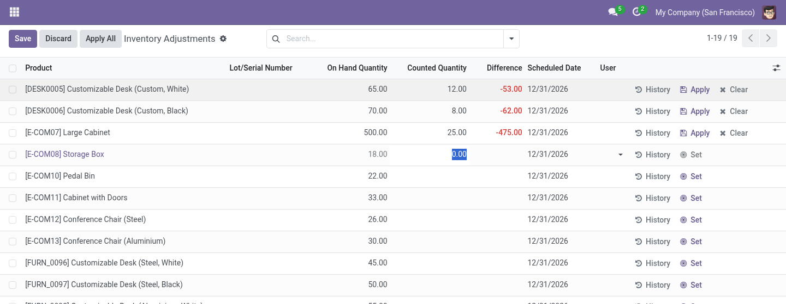

### List View Column Presets

Save the columns of a list view as presets, switch back in one click

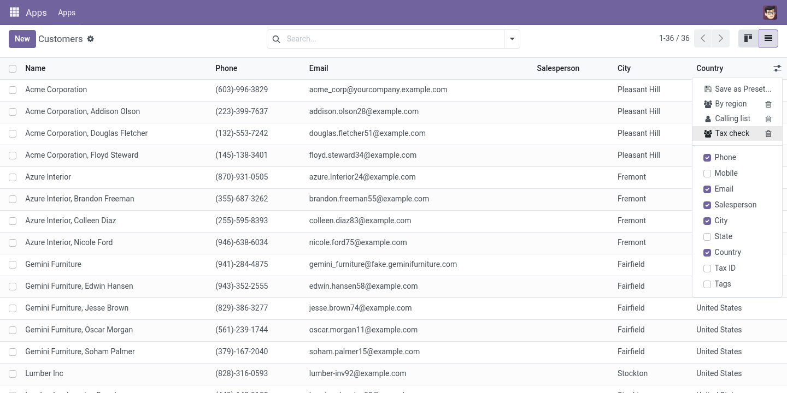

### Lost Emails

Keep incoming emails that Odoo cannot route, and route them by hand

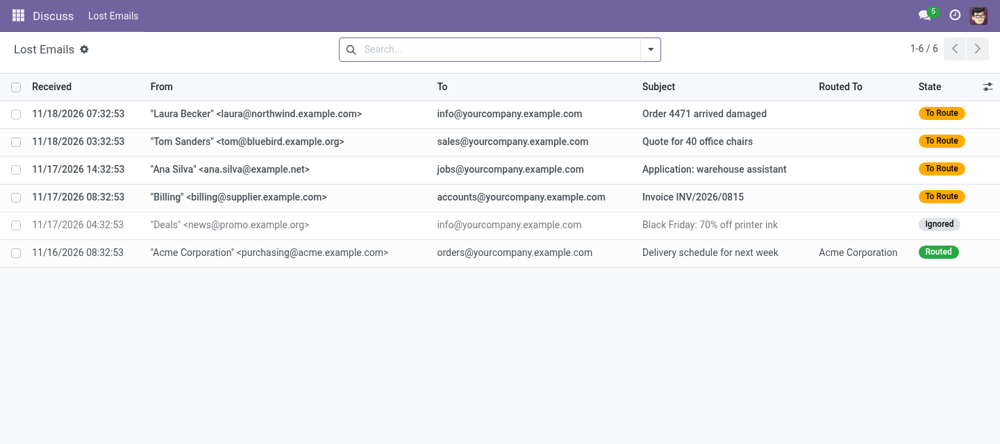

### Module Version

Display module version, track lifecycle history, and check for App Store updates

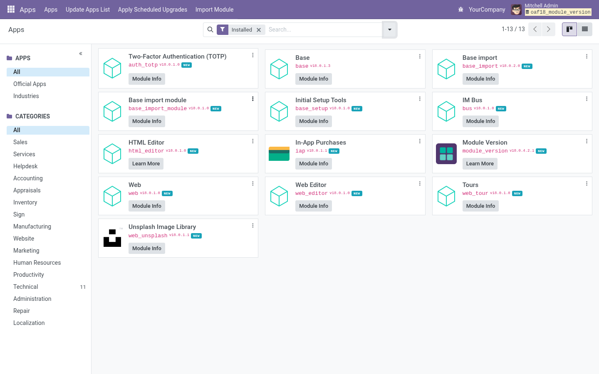

### Quick Language Switcher

Fast language switching from the Odoo interface

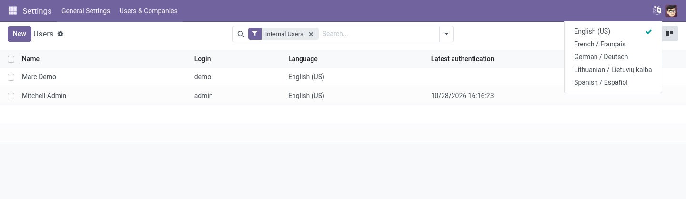

### Simple Online Users

Display online users count in systray

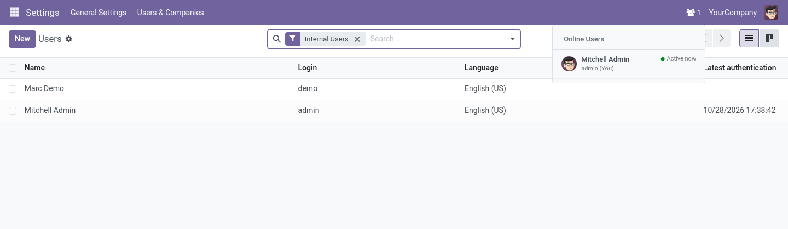

### Simple Scheduled Reports

Email any filtered list as a table and Excel file on a schedule

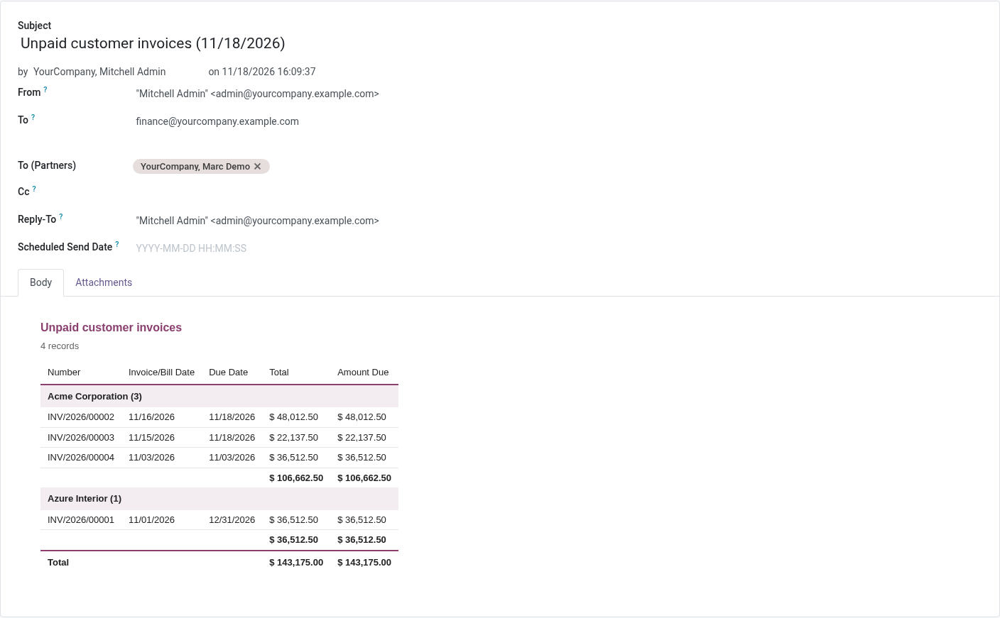

### Simple User Menu Sort

Each user sorts the main app menu in their own order

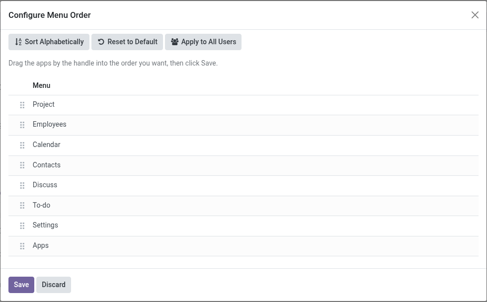

### User Activity Monitor

Track user login sessions and detect unusual activity patterns

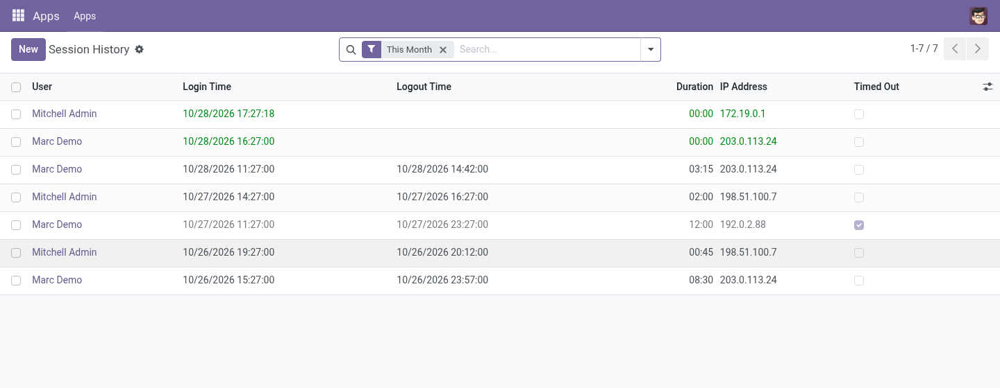

### User Permission Copy

Copy user permissions from one user to another

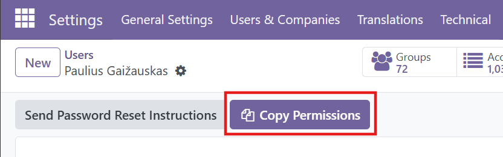

<!-- modules:end -->

## Install

```bash
git clone -b 17.0 https://github.com/Paulius11/odoo-custom-addons.git
```

Add the folder to `addons_path`, restart Odoo, then **Apps › Update Apps List** and install.

## Contributing

Bugs and ideas: [issues](https://github.com/Paulius11/odoo-custom-addons/issues). Pull requests go to
the branch of the Odoo series they target. Modules follow [OCA](https://odoo-community.org)
conventions; `pre-commit run --files $(find <module> -type f)` checks a new module.

## License

LGPL-3 unless a module's `__manifest__.py` says otherwise.
