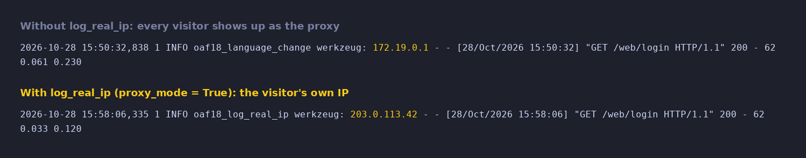
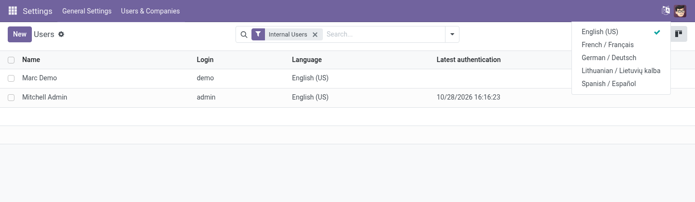
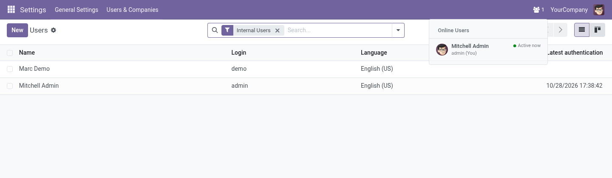
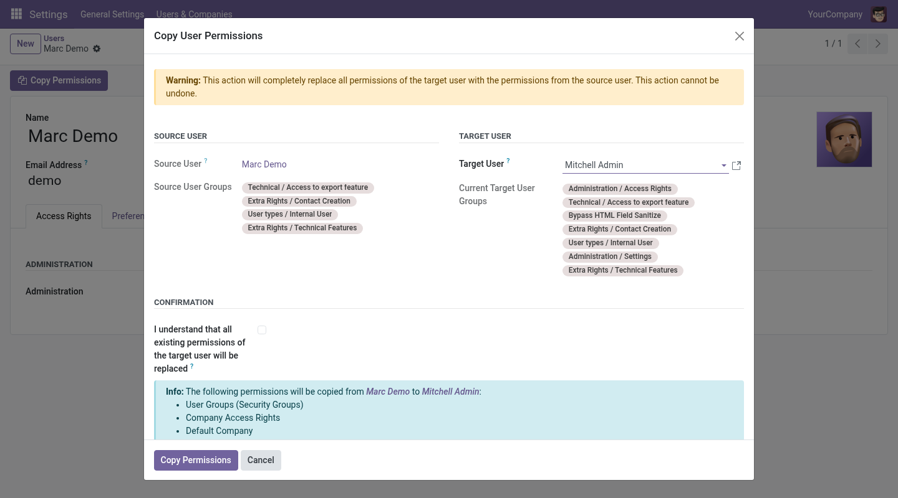

# Odoo Custom Addons

[](https://github.com/Paulius11/odoo-custom-addons/actions/workflows/test.yml?query=branch%3A18.0)
[](https://apps.odoo.com/apps/modules/browse?author=Paulius%20Gaizauskas)
[](https://www.gnu.org/licenses/lgpl-3.0)

Free, open-source Odoo modules for admins and everyday users. Each Odoo series has its own
branch (`17.0`, `18.0`, `19.0`, `20.0`); this is the **18.0** branch. All modules are
also on the [Odoo Apps Store](https://apps.odoo.com/apps/modules/browse?author=Paulius%20Gaizauskas).

## Modules

<!-- modules:start -->
| | Module | What it does | 17.0 | 18.0 | 19.0 |
|---|---|---|---|---|---|
|  | Debug Field Copy | Copy field names from debug tooltip | [✓](https://github.com/Paulius11/odoo-custom-addons/tree/17.0/debug_field_copy) |  |  |
|  | [Log Real IP](log_real_ip/) | Show real client IP in werkzeug logs when behind a reverse proxy |  | [✓](https://github.com/Paulius11/odoo-custom-addons/tree/18.0/log_real_ip) | [✓](https://github.com/Paulius11/odoo-custom-addons/tree/19.0/log_real_ip) |
|  | [Module Version](module_version/) | Display module version, track lifecycle history, and check for App Store updates | [✓](https://github.com/Paulius11/odoo-custom-addons/tree/17.0/module_version) | [✓](https://github.com/Paulius11/odoo-custom-addons/tree/18.0/module_version) | [✓](https://github.com/Paulius11/odoo-custom-addons/tree/19.0/module_version) |
|  | [Quick Language Switcher](language_change/) | Fast language switching from the Odoo interface | [✓](https://github.com/Paulius11/odoo-custom-addons/tree/17.0/language_change) | [✓](https://github.com/Paulius11/odoo-custom-addons/tree/18.0/language_change) | [✓](https://github.com/Paulius11/odoo-custom-addons/tree/19.0/language_change) |
|  | [Simple Online Users](simple_online_users/) | Display online users count in systray | [✓](https://github.com/Paulius11/odoo-custom-addons/tree/17.0/simple_online_users) | [✓](https://github.com/Paulius11/odoo-custom-addons/tree/18.0/simple_online_users) | [✓](https://github.com/Paulius11/odoo-custom-addons/tree/19.0/simple_online_users) |
|  | User Activity Monitor | Track user login sessions and detect unusual activity patterns | [✓](https://github.com/Paulius11/odoo-custom-addons/tree/17.0/user_activity_monitor) |  |  |
|  | User Message | Send a direct OdooBot message to a user from their profile | [✓](https://github.com/Paulius11/odoo-custom-addons/tree/17.0/elics_user_message) |  |  |
|  | [User Permission Copy](user_permission_copy/) | Copy user permissions from one user to another | [✓](https://github.com/Paulius11/odoo-custom-addons/tree/17.0/user_permission_copy) | [✓](https://github.com/Paulius11/odoo-custom-addons/tree/18.0/user_permission_copy) | [✓](https://github.com/Paulius11/odoo-custom-addons/tree/19.0/user_permission_copy) |

## Screenshots

### Log Real IP

Show real client IP in werkzeug logs when behind a reverse proxy



### Module Version

Display module version, track lifecycle history, and check for App Store updates


### Quick Language Switcher

Fast language switching from the Odoo interface



### Simple Online Users

Display online users count in systray



### User Permission Copy

Copy user permissions from one user to another



<!-- modules:end -->

## Install

```bash
git clone -b 18.0 https://github.com/Paulius11/odoo-custom-addons.git
```

Add the folder to `addons_path`, restart Odoo, then **Apps › Update Apps List** and install.

## Contributing

Bugs and ideas: [issues](https://github.com/Paulius11/odoo-custom-addons/issues). Pull requests go to
the branch of the Odoo series they target. Modules follow [OCA](https://odoo-community.org)
conventions; `pre-commit run --files $(find <module> -type f)` checks a new module.

## License

LGPL-3 unless a module's `__manifest__.py` says otherwise.
