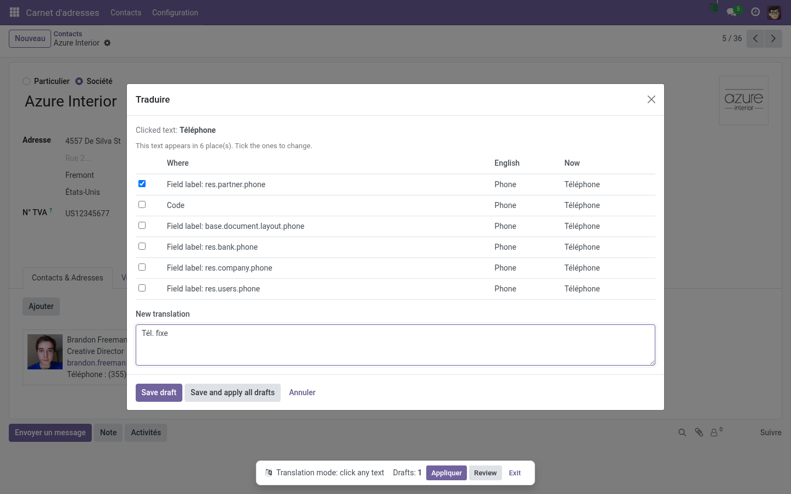

# Easy Translation Override

Click any Odoo text and change its translation: draft, apply, revert

## Why

Odoo's own translations do not always match the words your team uses, and fixing one means
finding the right `.po` file, the right module and the right field. This module lets a
translator click the text on screen, type the better word and apply it, without files,
developers or a restart. Every change can be undone.

## Features

- **Translation mode**: the language icon in the top bar turns it on; click any text, see every
  place it appears, tick the ones to change.
- **Every kind of text**: Python and JavaScript messages, menus, field labels, selection values,
  view text and action names.
- **Drafts first**: edits stay drafts until **Apply**; nobody sees a half-finished wording.
- **One Terms list**: every UI text in your language, searchable, with an editable
  *Your translation* column.
- **History and revert**: revert one text, one Apply, or everything back to Odoo's translation.
- **Survives upgrades**: changes come back after module upgrades and language reloads;
  uninstalling restores Odoo's own texts.
- **Safe input**: a translation that drops a placeholder (`%s`, `{name}`) or adds HTML is refused.

## Usage

1. Click the language icon in the top bar: the bar at the bottom says *Translation mode*.
2. Click a text, for example a field label. The popup lists every place with that text and
   ticks the one you clicked; type the new translation and click **Save draft**.
3. Click **Apply** in the bar: the page reloads with the new text. **Translate › History**
   shows the change and can revert it.

Without the mode: **Translate › Terms**, type in *Your translation*, then **Apply drafts**.

## Configuration

Only the group **Translator** sees the menu and the icon; Settings administrators have it.
Translate into the language of your user preferences: switch your own language to the one
you want to work on. **Refresh term list** in *Terms* after installing or upgrading modules
(the list also rebuilds itself when it notices).

## Technical

- **Depends on**: `web`
- **Models**: `translation.term` (the term index), `translation.override` (one changed text),
  `translation.change.set` and `translation.change` (History); `_inherit` of `ir.http`
  (web client translations) and `ir.module.module` (re-apply after a language reload)
- **Code texts** are laid over every module's `.po` per database and reach every worker on its
  next request; **database texts** are written into their translated field, with the original
  kept for revert.
- **Not covered**: QWeb views (reports, website, email templates) and business data such as
  product names (Odoo's own language button translates those).
- **Odoo versions**: see the branches of this repository (one branch per series)

## Support

Bugs and ideas: [GitHub issues](https://github.com/Paulius11/odoo-custom-addons/issues).
Free and open source under LGPL-3 by Paulius Gaizauskas.
