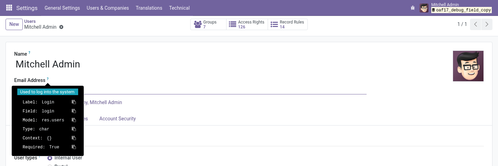

# Debug Field Copy

Copy field names, models and types from the developer-mode field tooltip.

## Why

Writing a domain, an xpath or a report means copying technical field names. Odoo's developer
tooltip shows them, but selecting the text by hand is fiddly and the tooltip closes when the
mouse moves. This module adds a copy button to each line and a pin to keep the tooltip open.

## Features

- **Copy buttons**: one per tooltip line (label, field, model, type, context, …)
- **Pin**: keeps the tooltip open while you move the mouse to it
- **Developer mode only**: normal users see no change

## Usage

1. Turn on developer mode (**Settings › Activate the developer mode**)
2. Hover the **?** next to any field label
3. Click the copy button next to the value you need

## Configuration

None: works right after install.

## Technical

- **Depends on**: `web`
- **Models**: none; a frontend patch of the field tooltip
- **Odoo versions**: see the branches of this repository (one branch per series)

## Support

Bugs and ideas: [GitHub issues](https://github.com/Paulius11/odoo-custom-addons/issues).
Free and open source under LGPL-3 by Paulius Gaizauskas.
