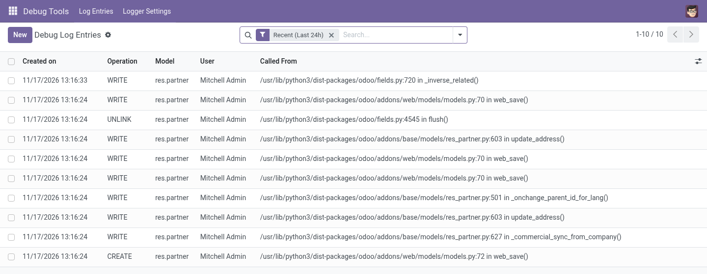
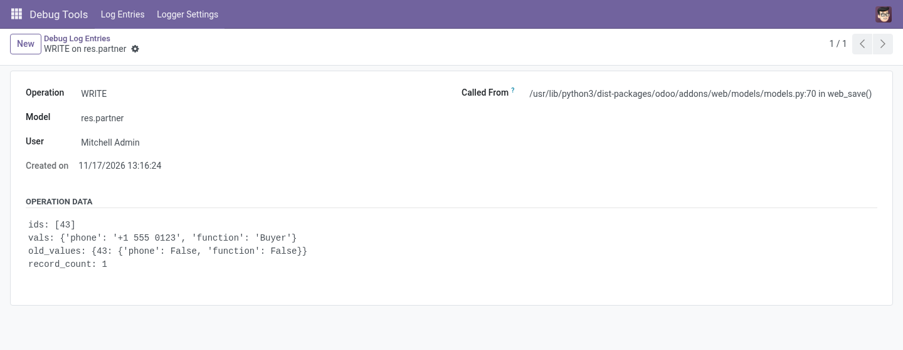
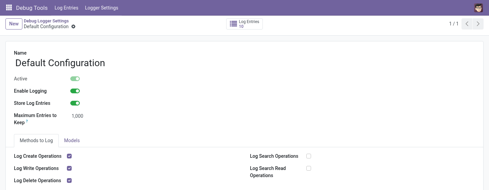

# Debug Logger

Log create, write, delete and search calls for debugging.

## Why

When a field changes and nobody knows why, you need to see which code wrote it, as which
user, and what the value was before. Odoo does not keep that trail; this module records it
for the models you pick, while you debug.

## Features

- **Create, write, delete**: every call on every model; `search` and `search_read` on request
- **The real caller**: file, line and method of the code that made the call, past Odoo's own
  wrappers and the other modules' overrides of the same method
- **Before and after**: a write keeps the old values, a delete keeps the record names
- **Only the models you pick**: all models, or a chosen few
- **Secrets masked**: keys that look like passwords, tokens or API keys show as `***`; long
  values (file contents) are cut at 1000 characters
- **Server log or database**: always written to the server log (INFO); optionally stored as
  entries, the oldest deleted past **Maximum Entries to Keep**

## Usage

1. Open **Debug Tools › Logger Settings**, turn on **Enable Logging**, and **Store Log Entries**
   to keep them in the database
2. Repeat the action you are debugging
3. Read **Debug Tools › Log Entries** (filter by operation, model, user, or search inside the
   operation data), or the server log

## Configuration

- Logging is off after install. Only one configuration is active: the last one created or
  activated with **Activate**.
- **Methods to Log**: create, write and delete are on by default, search and search_read off.
- **Models**: empty logs every model.
- Menus and data are for administrators only (`base.group_system`).
- Every logged call costs time, and logging all models floods the server log. Switch it off
  when done.

## Technical

- **Depends on**: `base`
- **Models**: `debug.logger.settings`, `debug.logger.entry`; `_inherit = "base"` overrides
  `create`, `write`, `unlink`, `search` and `search_read` on every model
- Calls made while installing or upgrading modules are not logged.
- Stored entries are part of the caller's transaction: when that transaction rolls back, its
  entries go too (the server log keeps them).
- **Odoo versions**: see the branches of this repository (one branch per series)

## Support

Bugs and ideas: [GitHub issues](https://github.com/Paulius11/odoo-custom-addons/issues).
Free and open source under LGPL-3 by Paulius Gaizauskas.
