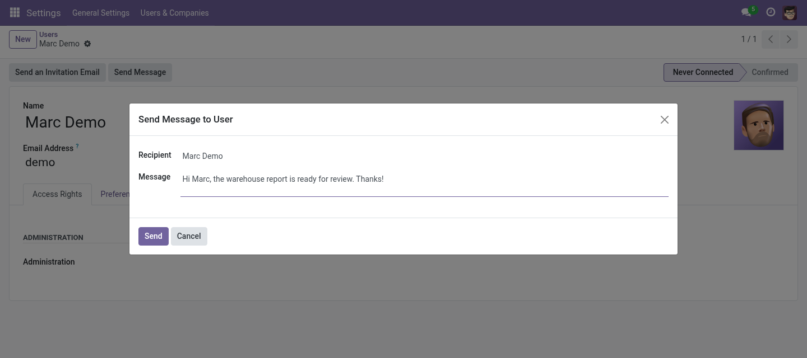

# User Message

Send a direct OdooBot message to a user from their profile.

## Why

Administrators sometimes need to tell one user something: a password reset, a changed
workflow, a reminder. Email can be missed; a Discuss chat from OdooBot shows up where the
user already works.

## Features

- **Send Message button** in the user form header
- **Delivered by OdooBot** as a direct chat, in the user's Discuss inbox
- **No setup**: uses Odoo's own Discuss and OdooBot

## Usage

1. Open a user in **Settings › Users & Companies › Users**
2. Click **Send Message**
3. Write the message and click **Send**

## Configuration

None: works right after install.

## Technical

- **Depends on**: `base`, `web`, `mail`
- **Models**: `elics.user.message.wizard` (transient); `_inherit` of `res.users`
- **Odoo versions**: see the branches of this repository (one branch per series)

## Support

Bugs and ideas: [GitHub issues](https://github.com/Paulius11/odoo-custom-addons/issues).
Free and open source under AGPL-3 by Paulius Gaizauskas.
