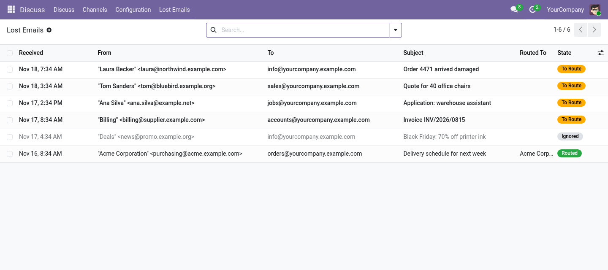
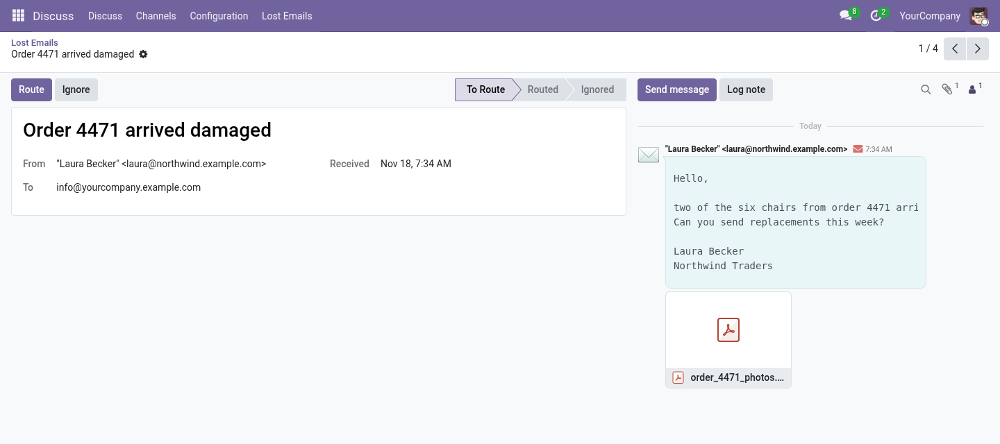
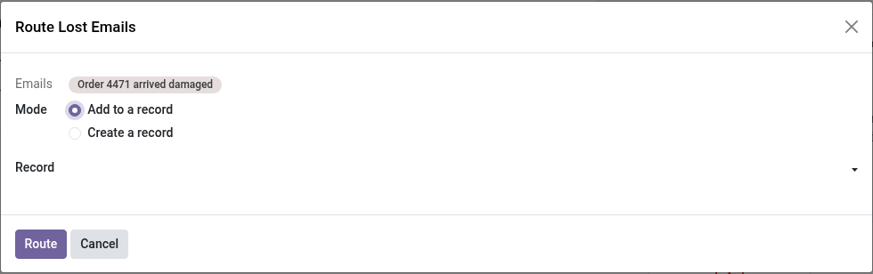

# Lost Emails

Keep incoming emails that Odoo cannot route, and route them by hand

## Why

When an email reaches Odoo and matches no alias, no reply thread and no default model, Odoo
gives up: an incoming mail server drops it, and the mail gateway bounces it back to the
sender. Nobody in the company sees it. This module keeps those emails in a list, so someone
can move each one to the record it belongs to.

## Features

- **No email bounced or dropped**: emails Odoo cannot route are kept, whether they come from
  an incoming mail server or the mail gateway.
- **The whole email**: sender, To, Cc, subject, body and attachments in the chatter; the
  original email is kept for routing.
- **Route to any record**: add one or several emails to any record with a chatter, as if they
  had arrived there. Attachments go with them.
- **Or create a record**: the email becomes a new record of the type you pick, named after its
  subject, the way an email alias creates one.
- **Replies find their way**: after routing, the sender's replies go to the same record.
- **Managers are told**: Lost Emails Managers follow every lost email and get notified.
- **Follow-ups stay separate**: a reply to an email that is still lost becomes a lost email
  of its own, so each can be routed.

## Usage

1. Open **Discuss › Lost Emails**. New lost emails are under **To Route**.
2. Open one and click **Route**. Pick the record it belongs to, or **Create a record** and
   pick the type.
3. Click **Route**: the email is posted on that record and the lost email shows **Routed**.
   Spam and noise: **Ignore**. Several at once: select them in the list,
   **Actions › Route**.

## Configuration

Access is limited to the **Lost Emails Manager** group; the administrator is in it after
install. Add other users in **Settings › Users**. Each manager follows every new lost email
and is notified the way their user preferences say (Odoo inbox or email).

To route an email, a manager needs the right to post on the target record (write access by
default) or to create records of the chosen type.

## Technical

- **Depends on**: `mail`
- **Models**: new `mail.lost` (a lost email, with the chatter) and `mail.lost.route` (the
  routing wizard); `mail.thread.message_route` is extended.
- **How it hooks in**: when core `message_route` raises "No possible route found", the email
  is routed to a new `mail.lost` record instead. Routing parses the kept original again and
  hands it to core `_message_route_process` with the chosen record, so the result is the same
  as if the email had arrived there.
- **Not caught**: emails written straight to the catchall address (core bounces them on
  purpose), bounce reports, and emails core ignores as duplicates or replies to its own
  bounces.
- **Odoo versions**: see the branches of this repository (one branch per series)

## Support

Bugs and ideas: [GitHub issues](https://github.com/Paulius11/odoo-custom-addons/issues).
Free and open source under LGPL-3 by Paulius Gaizauskas.
