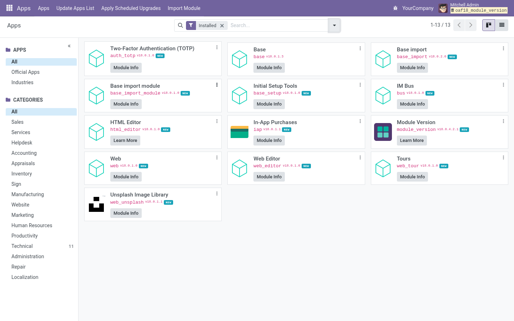

# Module Version

Display module version information and track complete module lifecycle history in Odoo.

## Features

- **Version Display**: Shows current installed version for all installed modules
- **Upgrade Detection**: Displays upgrade available indicator with version comparison
- **Automatic Detection**: Compares disk version (from manifest) vs installed version (from database)
- **Complete History**: Comprehensive audit trail of all module installations, upgrades, and uninstallations
- **Operation Tracking**: Records version changes, timestamps, users, and operation types
- **Search & Filter**: Find operations by module name, operation type, or date range
- **User Attribution**: See who performed each module operation
- **Timeline View**: Visual representation of module lifecycle events

## Installation

1. Download the module to your Odoo addons directory
2. Update the app list in your Odoo instance
3. Install "Module Version" from the Apps menu
4. Navigate to Apps to see version information
5. Access history from Settings → Technical → Module Upgrade History

## Configuration

No configuration required. The module works automatically after installation.

## Usage

### Viewing Current Versions

1. Go to Apps menu
2. Each installed module now shows its current version number
3. Modules with available upgrades show an "Upgrade Available" badge
4. Click the version to see detailed version comparison

### Viewing Module History

1. Navigate to Settings → Technical → Module Upgrade History
2. View complete list of all module operations
3. Filter by:
   - Operation Type (Install, Upgrade, Uninstall)
   - Module Name
   - Date Range
   - User
4. Each record shows:
   - Module name
   - Operation type
   - Previous version (for upgrades)
   - New version
   - Timestamp
   - User who performed the operation

### Understanding Upgrade Detection

- **Green Badge**: Module is up to date
- **Orange Badge**: Upgrade available (disk version > installed version)
- **Version Comparison**: Shows both current and available versions

## Use Cases

- **Audit Compliance**: Track all module changes for compliance and audit purposes
- **Troubleshooting**: Identify when issues started by correlating with module changes
- **Upgrade Planning**: See which modules need upgrades and plan accordingly
- **Change Management**: Maintain complete history of system modifications
- **Team Coordination**: Know who made what changes and when

## Technical Details

- **Dependencies**: `base`
- **Compatibility**: Odoo 17.0+
- **License**: LGPL-3
- **Database Tables**:
  - `module_upgrade_history`: Stores module operation history
- **Automatic Tracking**:
  - Hooks into Odoo's module installation/upgrade process
  - No manual tracking required
  - History persists even if module is uninstalled
