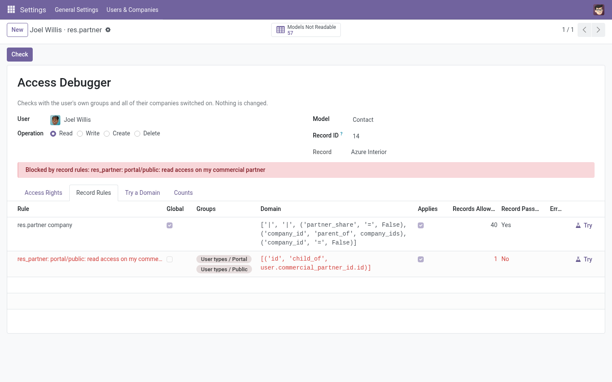
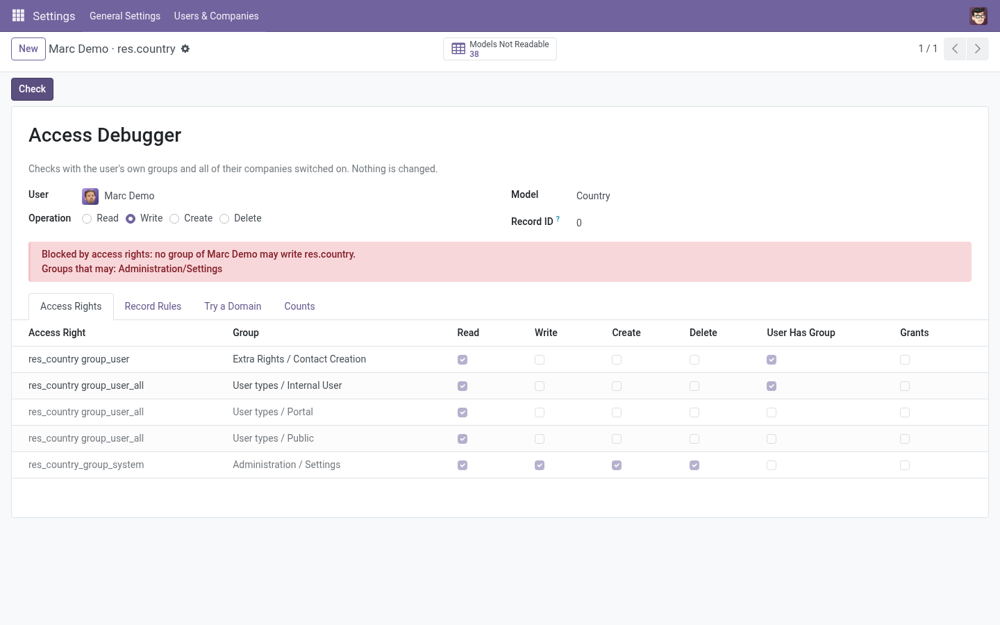
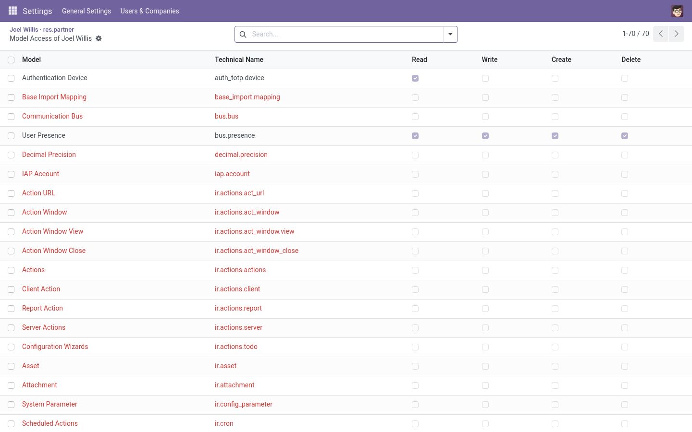

# Simple Access Debugger

See why a user can or cannot open a record: access rights, record rules, a verdict

## Why

"You are not allowed to access this document" tells the user nothing and the administrator
little more. Finding the cause means reading access rights and record rule domains by hand, or
logging in as the user. This module answers it on one screen: pick the user, the model, the
operation and a record, and it names the access right or the record rule that blocks them.
It only reads; nothing about the user or the rules is changed.

## Features

- **Verdict**: allowed, or blocked by access rights (with the groups that would allow it), or
  blocked by the named record rules.
- **Access rights**: every access right of the model, which of them the user's groups hold,
  and which one grants the operation.
- **Record rules**: every rule of the model, whether it applies to the user, how many records
  it lets through, and whether the chosen record passes.
- **Try a domain**: type a domain and see how many records it matches for that user, and
  whether the chosen record is one of them. **Try** on a rule copies its domain there.
- **Model access**: a list of every model with the user's read, write, create and delete
  rights; the ones they cannot read are red.
- **Log access errors** (optional): every refused access writes the user, their groups, the
  failing rules and the calling code into the server log.

## Usage

1. Go to **Settings › Users & Companies › Access Debugger**.
2. Pick a **User**, an **Operation** and a **Model**; add a **Record ID** to check one record.
3. Click **Check**: the verdict shows in green or red, the tabs below show why.
4. **Models Not Readable** opens the list of every model with that user's rights.

## Configuration

None: works right after install, for administrators (Settings group) only. To log every
refused access, switch on **Settings › General Settings › Permissions › Log Access Errors**.
A refusal of the same user, model, operation and records is logged once per 10 minutes.

## Technical

- **Depends on**: `base_setup`
- **Models**: `simple.access.debugger` and its lines (transient); extends `ir.model.access`
  and `ir.rule` for the optional log, `res.config.settings` for its switch
- **How it checks**: as the chosen user (`su=False`) with all of their companies switched on,
  using Odoo's own record rule evaluation, so the answer matches what the user gets
- **Odoo versions**: see the branches of this repository (one branch per series)

## Support

Bugs and ideas: [GitHub issues](https://github.com/Paulius11/odoo-custom-addons/issues).
Free and open source under LGPL-3 by Paulius Gaizauskas.
