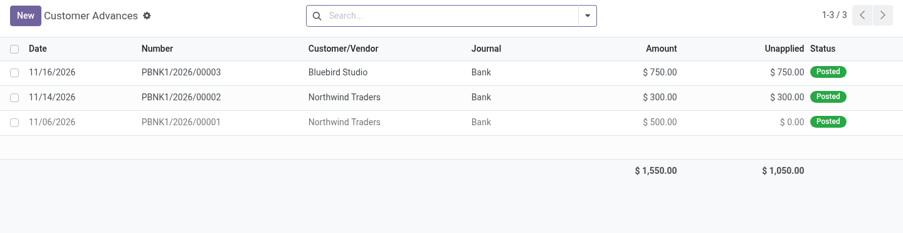
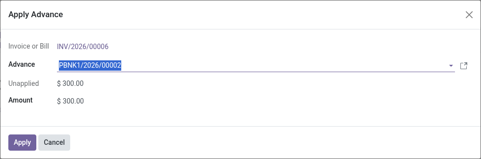
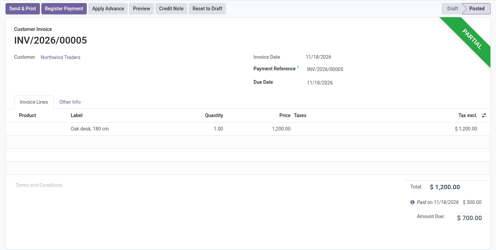

# Advance Payments

Customer deposits and vendor prepayments, applied to invoices later

## Why

A customer pays a deposit before you invoice, or you prepay a supplier before the bill
arrives. Odoo posts that money on the partner's receivable or payable, where it waits as an
outstanding credit. Accountants want deposits as a liability (and prepayments as an asset)
on an account of their own, a list of what is still unapplied, and an explicit step that
applies them to the invoice or bill. This module does that.

## Features

- **Deposits on their own account**: tick **Advance** on a payment and it posts to the
  company's customer advances or vendor prepayments account.
- **See what is unapplied**: **Customers › Advances** and **Vendors › Prepayments** list
  every advance with the amount still open (filter **Unapplied**).
- **Apply to the invoice**: **Apply Advance** on a posted invoice or bill proposes the oldest
  open advance of that partner (or its contacts); apply all of it or part.
- **One clear entry**: applying posts one miscellaneous entry from the advance account to the
  receivable or payable, reconciled with the invoice and with the advance.
- **Undo**: **Undo Advance** on that entry reverses it; the invoice is due again and the
  advance is open again.
- **Customers and vendors**: the same for customer deposits on invoices and vendor
  prepayments on bills.

## Usage

1. Register the deposit in **Customers › Advances** (or tick **Advance** on any draft
   payment) and confirm it.
2. Post the invoice. Click **Apply Advance**, check the advance and the amount, click
   **Apply**.
3. To take it back, open the entry named "Advance … on …" from the invoice's payment line
   and click **Undo Advance**.

## Configuration

**Invoicing › Configuration › Settings › Default Accounts › Advance payments**: pick two
accounts that are not the partners' own receivable or payable, both with *Allow
Reconciliation*:

- **Customer advances**: type *Payable* (it is a liability), e.g. "Customer Advances".
- **Vendor prepayments**: type *Receivable* (it is an asset), e.g. "Vendor Prepayments".

Odoo payments only post to receivable- or payable-type accounts, hence these types. An
advance cannot be confirmed until the account for its side is set. Applying needs a
miscellaneous journal.

## Technical

- **Depends on**: `account`
- **Models**: extends `account.payment` (`is_advance`, `advance_residual`, the counterpart
  account), `account.move` (`advance_payment_id`, Apply and Undo) and `res.company`; new
  wizard `account.advance.apply`.
- **Limits**: invoices and bills in the company currency only; advances are applied by hand;
  no VAT on advances (country rules differ).
- **Odoo versions**: see the branches of this repository (one branch per series)

## Support

Bugs and ideas: [GitHub issues](https://github.com/Paulius11/odoo-custom-addons/issues).
Free and open source under LGPL-3 by Paulius Gaizauskas.
