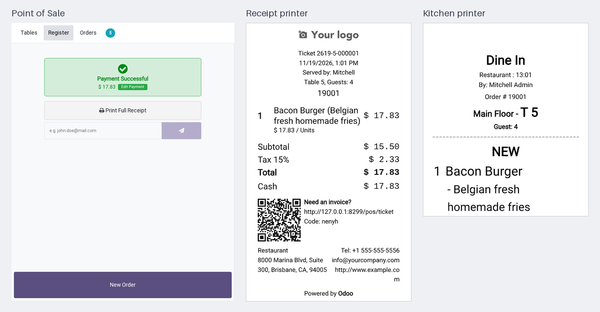
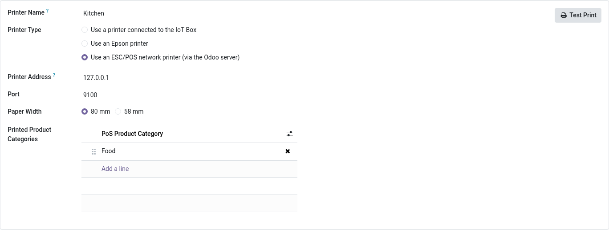
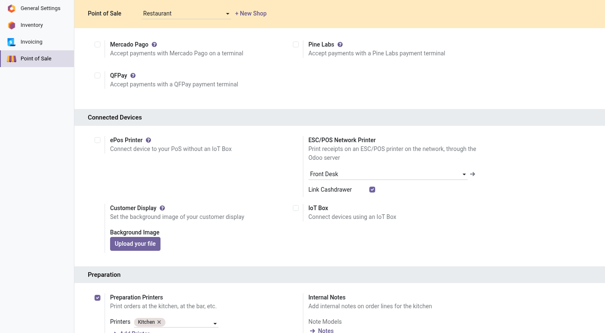
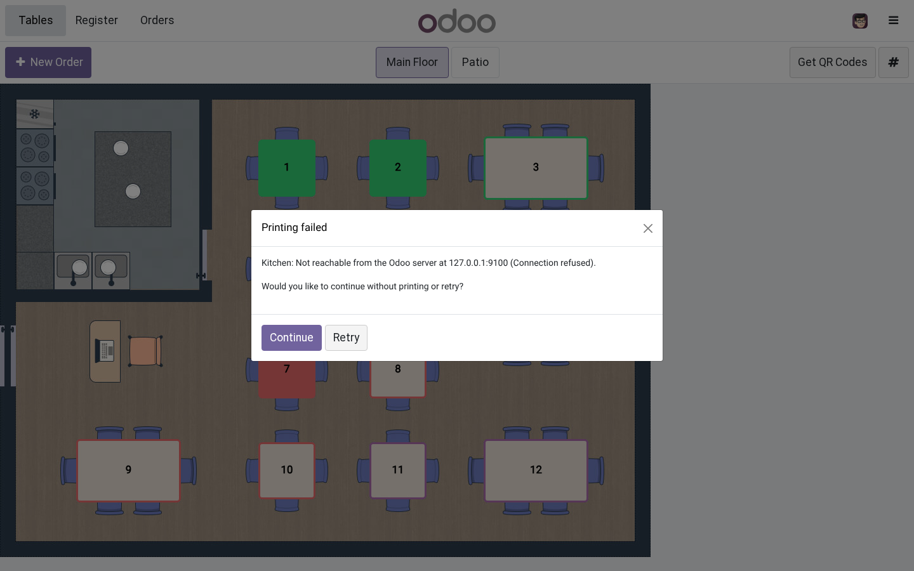

# POS Network Printer

Receipts and kitchen tickets on ESC/POS network printers, no IoT box

## Why

Odoo's Point of Sale prints to an ordinary thermal receipt printer only through an IoT box
(Epson ePOS models aside). Most shops already have an ESC/POS printer on the network. This
module lets the Odoo server print receipts and kitchen tickets on it and open the cash drawer.

## Features

- **Receipts**: choose the receipt printer in the POS settings; receipts and reprints
  print there.
- **Kitchen and bar tickets**: a third type for preparation printers, by POS category, as
  with core's IoT and Epson printers.
- **Cash drawer**: opens on cash payments and with **Open Cashbox**, for the drawer wired to
  the receipt printer.
- **Clear errors**: an unreachable printer shows its name, address and the cause, with Retry;
  the order is saved either way.
- **Test Print** on the printer form; **80 or 58 mm** paper; port 9100 by default.

## Usage

1. **Point of Sale › Configuration › Preparation Printers**: create a printer, type
   **ESC/POS network printer (via the Odoo server)**, enter its IP address, click **Test Print**.
2. **Point of Sale › Configuration › Settings**: pick it under **ESC/POS Network Printer** for
   receipts (and tick **Link Cashdrawer**), or under **Preparation Printers** for the kitchen.
3. Open the POS: kitchen tickets print when an order is sent, the receipt after payment.

## Configuration

The Odoo server must reach the printer over TCP (port 9100 by default): Odoo hosted in the
shop or on its network, or connected by VPN. Odoo.sh and other cloud hosts cannot reach a
printer in your shop. Only POS managers set printer addresses; cashiers send jobs by printer.

## Technical

- **Depends on**: `point_of_sale`
- **Models**: `pos.printer` gets the type `escpos_network` with address, port and paper width;
  `pos.config` gets `escpos_receipt_printer_id`.
- **How it prints**: a JS printer class (core `BasePrinter`) sends the receipt image the POS
  already renders to `/simple_pos_escpos_printer/print`. The server turns it into an ESC/POS raster
  (`GS v 0`) with Pillow, centred on 576 or 384 dots, ends with a cut (`GS V A`) and writes it
  to the printer over TCP. The drawer is `ESC p` on both pins. Printers without raster
  graphics (e.g. impact models) are not supported.
- **Tests**: a fake TCP printer in `tests/` checks the raster, paper widths, slicing, cut,
  drawer, errors and access to the routes.
- **Odoo versions**: see the branches of this repository (one branch per series)

## Support

Bugs and ideas: [GitHub issues](https://github.com/Paulius11/odoo-custom-addons/issues).
Free and open source under LGPL-3 by Paulius Gaizauskas.
