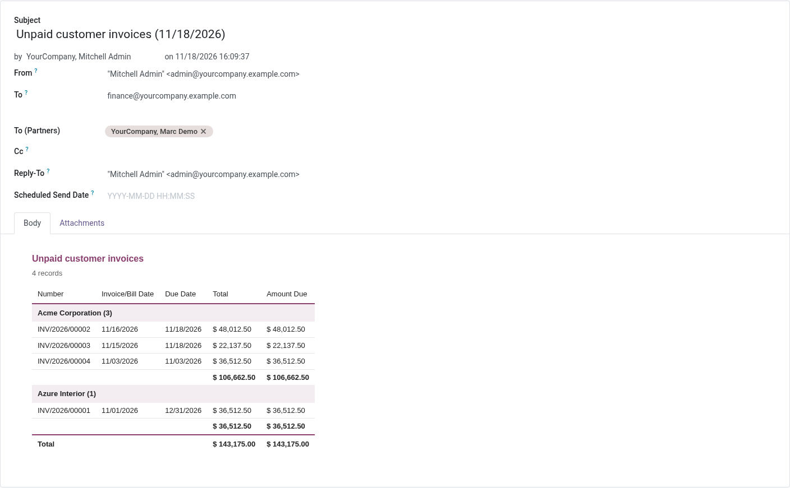

# Simple Scheduled Reports

Email any filtered list as a table and Excel file on a schedule

## Why

Many teams open the same filtered list every week: overdue invoices, yesterday's deliveries,
open leads. This module mails that list on a schedule instead, as a table in the email and an
Excel file. Each report reads the records as its owner, so it mails only what the owner may see.

## Features

- **Any list**: pick a model, build the filter with Odoo's domain editor, choose the columns.
- **Table and Excel file**: the list in the email body, plus an `.xlsx` with every row.
- **Groups and totals**: optional group by, with subtotals and a grand total for amounts.
- **Schedule**: daily, on chosen weekdays, or on a day of the month, at an hour in the owner's timezone.
- **Date periods**: keep the last N days, weeks or months, or this one, on any date field.
- **Access rights**: the report runs as its owner, so record rules apply.
- **Skip if empty**: send nothing when no record matches.
- **Send Now**: mail the report at once; every send is logged in the chatter with its Excel file.

## Usage

1. **Discuss › Scheduled Reports › New**: pick the model, the filter and the columns.
2. In **Schedule**, choose how often and at what time; in **Recipients**, pick users, contacts
   or other addresses.
3. Click **Send Now** to get the first email at once; after that it arrives on schedule.

## Configuration

Only members of the group **Scheduled Reports Manager** see the menu and create reports (the
administrator has it). A manager owns and edits only their own reports; administrators see all
of them. A cron job checks for due reports every 15 minutes.

## Technical

- **Depends on**: `mail`
- **Models**: `simple.scheduled.report` (with `mail.thread`), `simple.scheduled.report.column`
- **Odoo versions**: see the branches of this repository (one branch per series)

## Support

Bugs and ideas: [GitHub issues](https://github.com/Paulius11/odoo-custom-addons/issues).
Free and open source under LGPL-3 by Paulius Gaizauskas.
