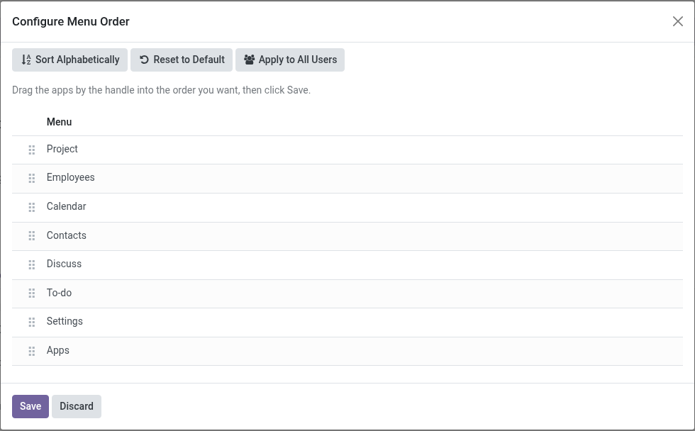

# Simple User Menu Sort

Each user sorts the main app menu in their own order.

## Why

Odoo shows the apps in one fixed order for everybody. A salesperson and an accountant open
different apps all day; this module lets each of them put their own apps first.

## Features

- **Your own order**: drag the apps into place; other users keep their order
- **No admin rights needed**: regular users change it from their own Preferences
- **Default for everyone**: an administrator applies their order to all users, and new users start with it
- **Sort A to Z or reset**: one click sorts alphabetically or puts back the default order

## Usage

1. Avatar menu › **Preferences** › **Configure Menu Order**
2. Drag the apps by the handle and click **Save**
3. The page reloads and the app menu shows the new order

Apps installed later are added to the list the next time you open **Configure Menu Order**.

## Configuration

None: works right after install. Only administrators see **Apply to All Users**.

## Technical

- **Depends on**: `base`, `web`
- **Models**: `user.menu.sort` (new); `res.users` and `ir.ui.menu` (`load_menus` sorts the root apps per user)
- **Odoo versions**: see the branches of this repository (one branch per series)

## Support

Bugs and ideas: [GitHub issues](https://github.com/Paulius11/odoo-custom-addons/issues).
Free and open source under LGPL-3 by Paulius Gaizauskas.
