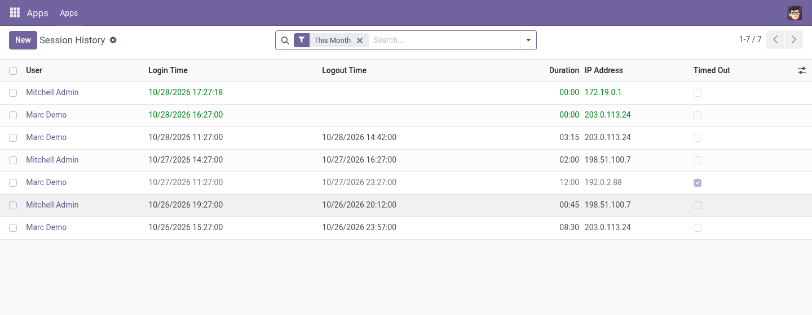

# User Activity Monitor

Track user login sessions and spot unusual activity.

## Why

Odoo does not keep a readable login history. When an account behaves oddly, you want to
know when it logged in, from where, for how long, and whether that happened at night.

## Features

- **Session history**: user, login and logout time, duration, IP address, browser
- **Filters**: still open, timed out, night sessions (00:00-06:00 UTC), today / week / month;
  group by user, date, hour or IP
- **Abandoned sessions closed**: an hourly job closes sessions with no logout after 12 hours
  and marks them timed out
- **Import past logins** from the Odoo log file (the path defaults to Odoo's `logfile` setting)

## Usage

1. Turn on developer mode
2. Open **Settings › Technical › User Activity › Session History**
3. Optional: **Import from Log File** to load logins from before the install

## Configuration

None. The menus are visible to administrators (`base.group_system`).

## Technical

- **Depends on**: `base`, `web`, `bus`
- **Models**: `user.session.log`, `user.activity.log.import.wizard` (transient)
- **Odoo versions**: see the branches of this repository (one branch per series)

## Support

Bugs and ideas: [GitHub issues](https://github.com/Paulius11/odoo-custom-addons/issues).
Free and open source under AGPL-3 by Paulius Gaizauskas.
