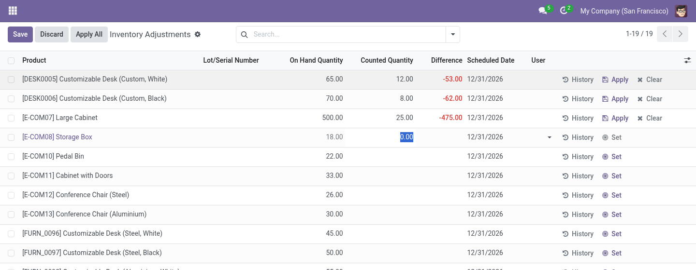
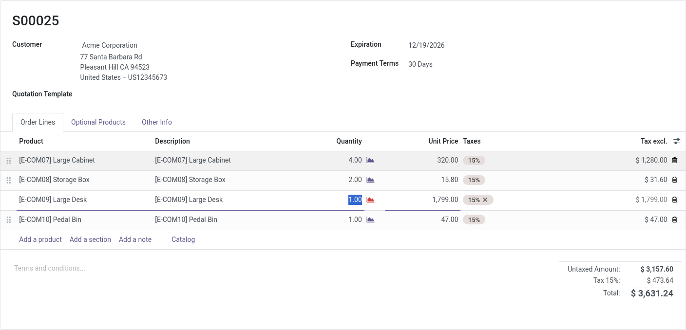

# List Arrow Keys

Arrow keys move between cells of an editable list, like a spreadsheet

## Why

While you type in a cell of an editable list, Odoo keeps the arrow keys inside the text box.
To reach the cell below you press Enter, which lands in the first column of the next line, or
reach for the mouse. Counting stock or changing quantities on many order lines means the same
detour on every line. With this module you type, press Down, and type the next value.

## Features

- **Up and Down**: go to the same column on the line above or below; the line you leave is
  saved first, as with Enter.
- **Enter goes down**: Enter also keeps the column. On a new line or the last line it still
  adds a line, as before.
- **Left and Right**: move the text cursor first; at the start or end of the text they go to
  the previous or next cell. A cell you just entered has its value selected, so one press
  moves on.
- **Everywhere**: list views and the lines inside forms (order lines, invoice lines, stock
  counts). No setup.

## Usage

1. Open an editable list, e.g. **Inventory › Operations › Physical Inventory**, or the order
   lines of a quotation.
2. Click a cell, type a value and press **Down**: the line is saved and the cursor is in the
   same column one line lower.
3. Use **Left** and **Right** to move along the line, **Tab** and **Escape** as before.

## Configuration

None: works right after install.

## Technical

- **Depends on**: `web`
- **Models**: none. `ListRenderer.onCellKeydown` is patched and only acts while a line is
  being edited. Left alone: dropdown fields (many2one search, selection), number inputs, Up
  and Down inside a multi-line text except at its first or last character, and multi-editing
  of selected records.
- **Tests**: QUnit tests in `static/tests/`, run by `tests/` when Chrome is available.
- **Odoo versions**: see the branches of this repository (one branch per series)

## Support

Bugs and ideas: [GitHub issues](https://github.com/Paulius11/odoo-custom-addons/issues).
Free and open source under LGPL-3 by Paulius Gaizauskas.
