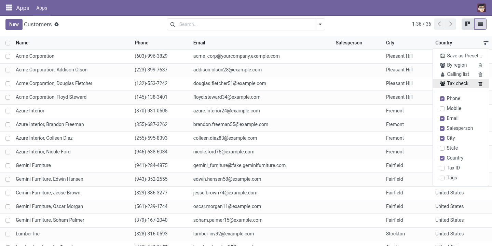
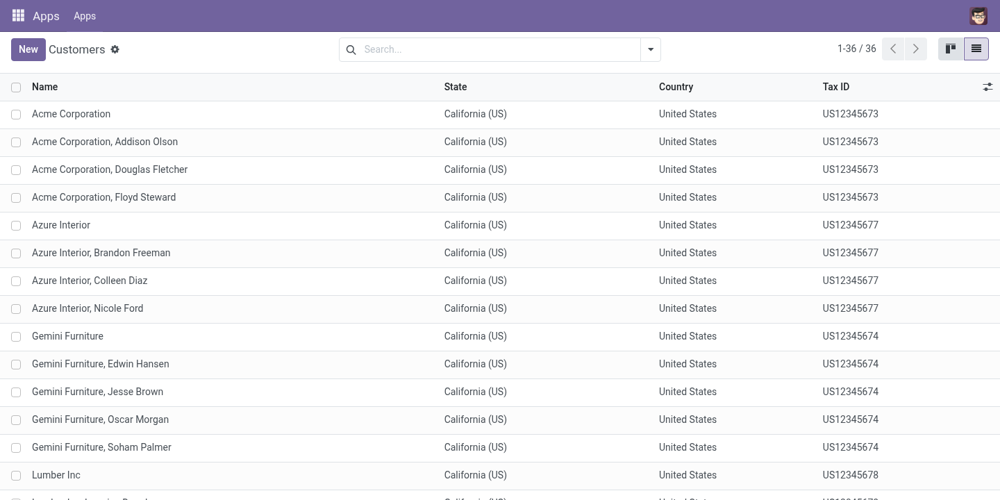
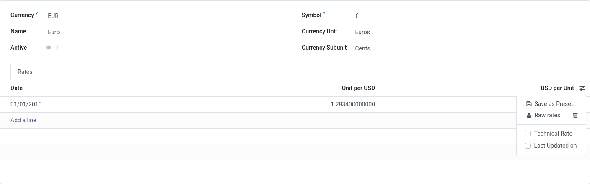
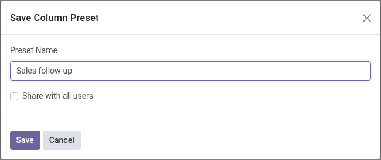

# List View Column Presets

Save the columns of a list view as presets, switch back in one click

## Why

Odoo lets every user choose which optional columns a list shows, but it keeps only one
choice per list. Someone who checks phone numbers in the morning and tax IDs in the afternoon
ticks the same boxes again and again. This module saves each set of columns under a name.

## Features

- **Switch in one click**: a preset turns on its columns and turns off the other optional
  ones; Odoo remembers the result as if you had ticked them yourself.
- **Personal presets**: every user saves their own; nobody else sees them.
- **Shared presets**: users in the **Manage Shared Column Presets** group save presets for
  everyone. Everyone can use them; only that group can delete them.
- **Lists inside forms too**: order lines, invoice lines, rates: any embedded list with
  optional columns gets the same menu.
- **Delete from the menu**: the bin icon next to a preset deletes it after a confirmation; it
  shows only on presets you may delete.
- **One list for administrators**: every saved preset in **Settings › Technical › User
  Interface › List View Column Presets** (developer mode).

## Usage

1. Open any list and click the column icon at the right end of the header. Tick the columns
   you want.
2. In the same menu, click **Save as Preset...**, enter a name, tick **Share with all users**
   if you may and want to, and click **Save**.
3. Click the preset later to get exactly those columns back.

## Configuration

None for personal presets. Administrators (Settings) are in **Manage Shared Column Presets**
after install; to add other users, open **Settings › Users** in developer mode and tick the
group under **Technical**.

## Technical

- **Depends on**: `web`
- **Model**: `ir.listview.column.preset` (name, model, owner, column names as JSON). A preset
  with no owner is shared. Record rules: users read their own and the shared ones; they
  create, change and delete only their own; the shared-presets group manages the shared ones.
- **Web client**: `ListRenderer` is patched; the template adds the presets at the top of the
  optional-columns dropdown. Applying a preset follows core's own column toggle, so the
  choice is stored in the browser like a manual one.
- **Scope**: presets belong to a model, not to a view. A preset saved on Customers also
  shows in every other list of contacts, and only its optional columns apply there.
- **Odoo versions**: see the branches of this repository (one branch per series)

## Support

Bugs and ideas: [GitHub issues](https://github.com/Paulius11/odoo-custom-addons/issues).
Free and open source under LGPL-3 by Paulius Gaizauskas.
